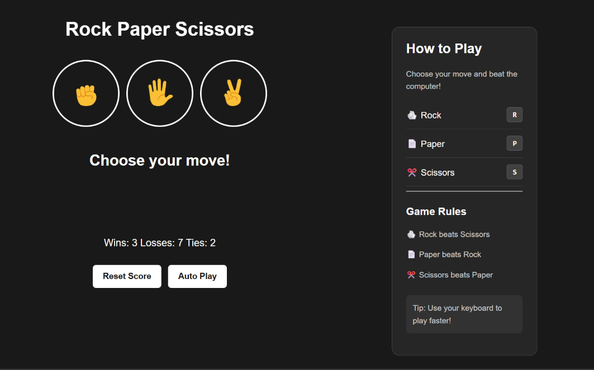

# ✊ Rock Paper Scissors

An interactive, browser-based **Rock Paper Scissors** game built using HTML, CSS, and JavaScript. Play against the computer, track your scores, and use keyboard shortcuts for a faster gaming experience.

## ✨ Features

- **Interactive Gameplay** — Choose Rock, Paper, or Scissors to play against the computer.
- **Score Tracking** — Keep track of wins, losses, and ties.
- **Persistent Scores** — Saves game statistics using browser `localStorage`.
- **Keyboard Shortcuts** — Press `R` for Rock, `P` for Paper, and `S` for Scissors.
- **Auto Play** — Automatically plays consecutive rounds until stopped.
- **Reset Score** — Clear your current score and start fresh.
- **Responsive Design** — Layout adapts to smaller screens.
- **Game Rules** — Includes an in-game guide to help players.

## 🛠️ Technologies Used

- **HTML5** — Structures the game interface.
- **CSS3** — Provides styling, layout, hover effects, and responsive design.
- **JavaScript** — Implements game logic, event handling, random computer moves, and score management.
- **Web Storage API** — Stores scores in the browser using `localStorage`.

## 📸 Preview

<!-- Add a screenshot of your game to the screenshots folder. -->


## 📂 Project Structure

```text
Rock-Paper-Scissors/
├── images/
│   ├── rock-emoji.png
│   ├── paper-emoji.png
│   └── scissors-emoji.png
├── screenshots/
│   └── rock-paper-scissors.png
├── index.html
├── styles.css
├── scripts.js
└── README.md
```

## 🚀 Getting Started

### Prerequisites

A modern web browser. No additional installation or dependencies are required.

### Run Locally

1. Clone the repository:

   ```bash
   git clone https://github.com/erranagishiva/Rock-Paper-Scissors.git
   ```

2. Open the project folder:

   ```bash
   cd Rock-Paper-Scissors
   ```

3. Open `index.html` in your browser.

Alternatively, open the project in VS Code and use the Live Server extension.

## 🎮 How to Play

1. Select Rock, Paper, or Scissors using the buttons.
2. The computer randomly chooses its move.
3. The result and updated score appear on the screen.
4. Use the keyboard shortcuts to play:
   - `R` — Rock
   - `P` — Paper
   - `S` — Scissors
5. Select **Auto Play** to start or stop automatic rounds.
6. Select **Reset Score** to clear your current statistics.

### Game Rules

- Rock beats Scissors.
- Scissors beats Paper.
- Paper beats Rock.
- Matching moves result in a tie.

## 📚 What I Learned

- DOM manipulation and event listeners.
- JavaScript functions, conditionals, and random number generation.
- Managing and updating application state.
- Saving and retrieving data with `localStorage`.
- Creating responsive layouts using CSS Flexbox and media queries.

## 🔮 Future Improvements

- Add sound effects and animations.
- Improve keyboard controls and accessibility.
- Add a game history feature.
- Enhance the mobile experience.

## 👨‍💻 Author

**Shiva Erranagi**

- GitHub: [erranagishiva](https://github.com/erranagishiva)
- LinkedIn: [Erranagi Shiva](https://linkedin.com/in/erranagi-shiva-54412131a/)

---

If you enjoy this project, consider giving the repository a ⭐.
